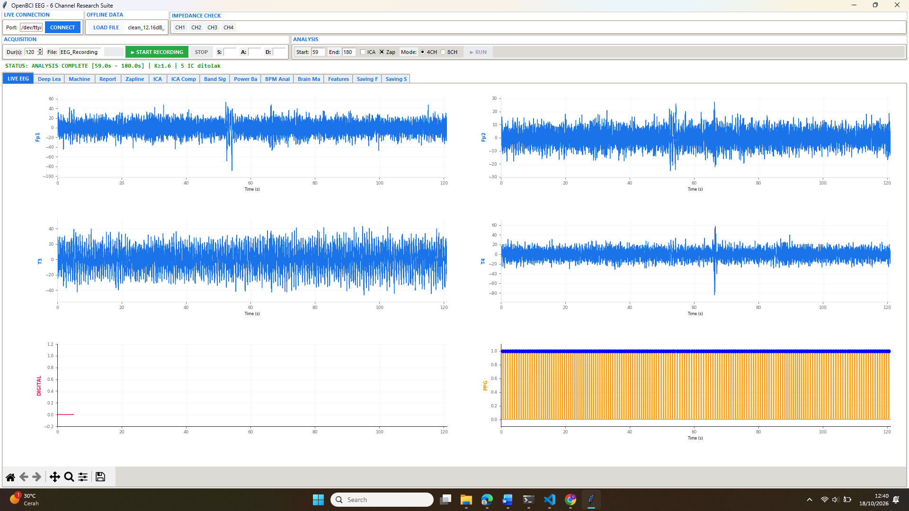
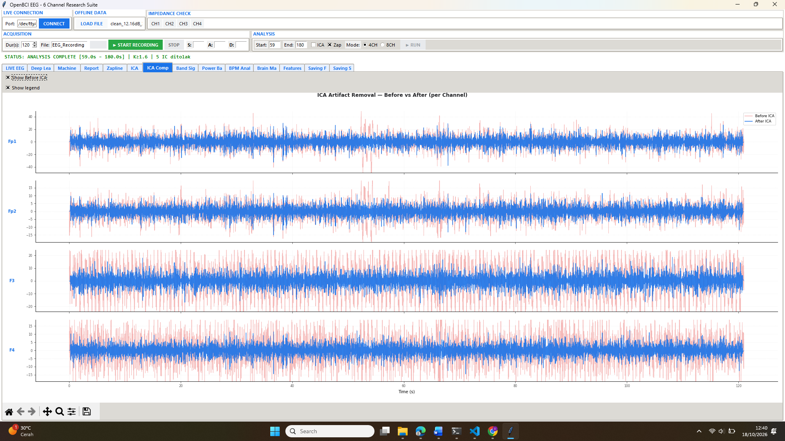
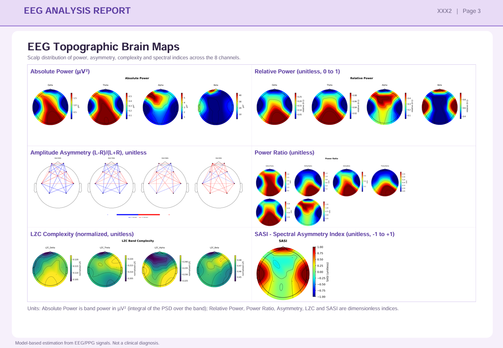
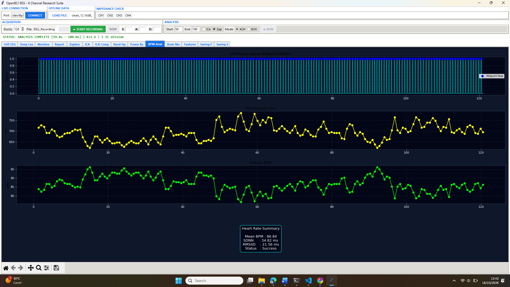
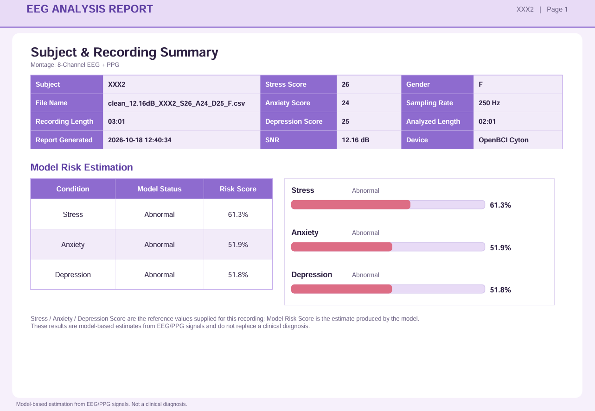

# Hi-Mind

**Sistem Deteksi Gangguan Kesehatan Mental Berbasis EEG dan PPG dengan Visualisasi Topographic Brain Mapping**

Hi-Mind adalah aplikasi desktop (GUI Tkinter) yang merekam atau memuat sinyal **EEG 4 kanal + PPG**, membersihkannya, memperkirakan 4 kanal EEG tambahan dengan model *Super-Resolution* (SR), mengekstraksi fitur, lalu memprediksi risiko **stres, kecemasan (anxiety), dan depresi**. Hasilnya ditampilkan sebagai *topographic brain map* dan dapat diekspor ke laporan PDF.

> ⚠️ **Disclaimer:** Hi-Mind adalah alat penelitian/skrining awal, **bukan alat diagnosis medis**. Hasil prediksi tidak menggantikan penilaian psikolog, psikiater, atau dokter.

---

## Tampilan Aplikasi

| Antarmuka utama | Hasil preprocessing |
|---|---|
|  |  |

| Topographic brain mapping | Heart rate Output |
|---|---|
|  |  |

**Contoh laporan PDF**



---

## Fitur

- Akuisisi real-time dari board **OpenBCI Cyton** (via BrainFlow) **atau** analisis dari file `.csv` / `.txt` tanpa perangkat keras.
- Preprocessing EEG: bandpass, Zapline, ICA/MAICA.
- **EEG Super-Resolution P16**: 4 kanal fisik (Fp1, Fp2, T7/T3, T8/T4) menjadi 8 kanal (+ F3, F4, P3, P4).
- Ekstraksi fitur EEG (band power, rasio, asimetri, LZC, SASI, konektivitas MI, dll.) dan fitur PPG (termasuk DFA α2).
- Klasifikasi **stress / anxiety / depression** dengan SVM RBF (inferensi NumPy manual).
- Visualisasi **topographic brain mapping**: absolute power, relative power, ratio, asymmetry, LZC, SASI.
- Ekspor laporan PDF.

## Alur Pemrosesan

```
EEG 4ch + PPG → Preprocessing (bandpass, Zapline, ICA)
              → EEG-SR P16 (Fp1,Fp2,T7,T8 → +F3,F4,P3,P4)
              → Ekstraksi fitur EEG + PPG
              → SVM boundary (stress / anxiety / depression)
              → Topomap + Laporan PDF
```

Segmen analisis: 120 detik pada 250 Hz.

## Struktur Repositori

```
Hi-Mind/
├── interface_fix.py                  # Aplikasi utama (GUI + pipeline deployment)
├── eeg_processor_8.py                # Preprocessing EEG (Zapline, ICA, SNR)
├── olah_data_lengkap.py              # Fungsi ekstraksi fitur EEG & PPG
├── requirements.txt
├── LICENSE
├── images/                           # Screenshot untuk README
├── DEPLOY_EEG_SR_P16_C10B/
│   ├── models/p16_sr_model_deploy.pt
│   ├── config/p16_sr_deploy_config.json
│   └── scripts/eeg_sr_hybrid_fusion.py
├── DEPLOY_cuml_boundary_stress_8CH_ALL_PPG/
│   └── cuml_svm_stress_rbf_cpu_boundary_UPDATED_THRESHOLD.pkl
├── DEPLOY_cuml_boundary_anxiety_8CH_ALL_PPG/
│   └── cuml_svm_anxiety_rbf_cpu_boundary_UPDATED_THRESHOLD.pkl
└── DEPLOY_cuml_boundary_depression_8CH_ALL_PPG/
    └── cuml_svm_depression_rbf_cpu_boundary_UPDATED_THRESHOLD.pkl
```

> Nama folder dan file di atas harus sama persis, karena dicari langsung oleh aplikasi.
>
> `eeg_sr_hybrid_fusion.py` berisi definisi arsitektur model SR sekaligus kode pelatihannya. Untuk menjalankan aplikasi, file ini hanya dimuat sebagai sumber arsitektur; pelatihan ulang membutuhkan dataset sendiri (variabel lingkungan `DATA_ROOT` dan `OUTPUT_ROOT`).

## Instalasi

Prasyarat: **Python 3.10 – 3.12**. Tidak perlu GPU maupun board Cyton.

```bash
git clone https://github.com/<username>/Hi-Mind.git
cd Hi-Mind

python -m venv venv
# Windows
venv\Scripts\activate
# Linux / macOS
source venv/bin/activate

pip install -r requirements.txt
```

Pengguna Linux: pasang Tkinter dengan `sudo apt install python3-tk`.

## Menjalankan

```bash
python interface_fix.py
```

### Tanpa board Cyton (mode file)
Gunakan menu pemilihan file di GUI untuk memuat rekaman `.csv` / `.txt` (EEG 4 kanal: Fp1, Fp2, T3/T7, T4/T8, plus kanal PPG), lalu jalankan preprocessing dan analisis seperti biasa.

### Dengan board Cyton
Hubungkan dongle, isi nomor port pada kolom **COM** di GUI (mis. `COM3`), lalu mulai rekaman.

## Model

| Model | Fungsi | Lokasi |
|---|---|---|
| EEG-SR P16 (C10B) | Estimasi F3, F4, P3, P4 | `DEPLOY_EEG_SR_P16_C10B/` |
| SVM Stress | Prediksi stres | `DEPLOY_cuml_boundary_stress_8CH_ALL_PPG/` |
| SVM Anxiety | Prediksi kecemasan | `DEPLOY_cuml_boundary_anxiety_8CH_ALL_PPG/` |
| SVM Depression | Prediksi depresi | `DEPLOY_cuml_boundary_depression_8CH_ALL_PPG/` |

Jika file model terlalu besar untuk GitHub (> 100 MB), unduh dari: **[ISI LINK DI SINI]** dan letakkan sesuai struktur di atas.

> 🔒 File `.pkl` dibuka dengan `pickle`. Jangan memuat file `.pkl` dari sumber yang tidak Anda percaya.

## Privasi Data

Repositori ini **tidak** menyertakan data rekaman pasien. Berkas `feature.csv`, `signal.csv`, `processing_signal/`, dan `DEPLOY_OUTPUT_GUI/` dikecualikan lewat `.gitignore`. Jangan meng-upload data biometrik tanpa persetujuan subjek.

## Pemecahan Masalah

| Masalah | Solusi |
|---|---|
| `ModuleNotFoundError: tkinter` | Linux: `sudo apt install python3-tk` |
| `File arsitektur SR tidak ditemukan` | Pastikan folder `DEPLOY_EEG_SR_P16_C10B/scripts/` ada dan namanya benar |
| `Artifact SVM tidak ditemukan` | Periksa nama folder dan file `.pkl` model |
| Error `np.trapz` | Gunakan NumPy terbaru; patch kompatibilitas sudah ada di kode |

## Sitasi

```
Ramadhani, A. L. (2026). Hi-Mind: Sistem Deteksi Gangguan Kesehatan Mental Berbasis
EEG dan PPG dengan Visualisasi Topographic Brain Mapping. GitHub repository.
```

## Lisensi

Kode dirilis di bawah lisensi [MIT](LICENSE).

## Penulis

**Andi Lisnaini Ramadhani**  
Institut Teknologi Sepuluh Nopember (ITS), Surabaya  
✉️ ramadhanilisna04@gmail.com
